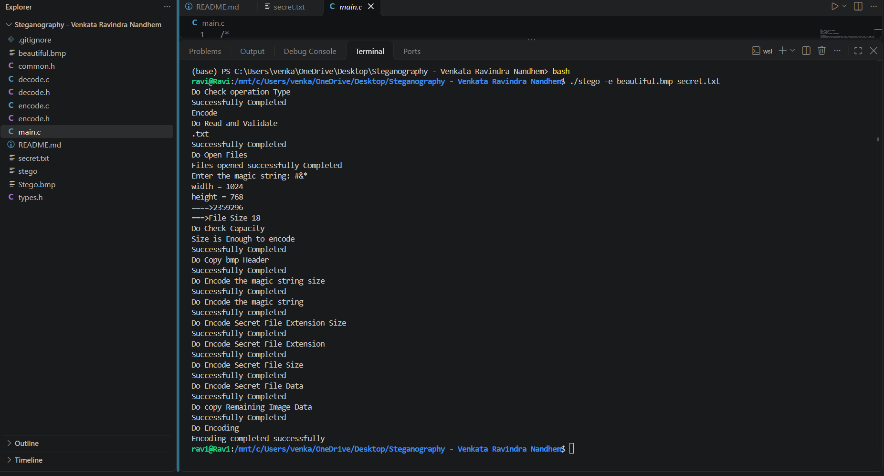
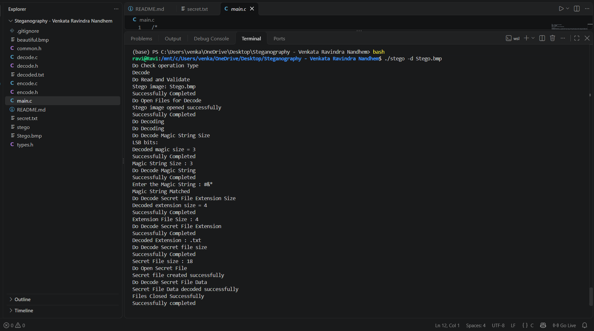

# LSB Image Steganography

## Project Description

LSB Image Steganography is a C-based application used to securely hide secret text messages inside BMP images without visibly changing the image.

The project uses the Least Significant Bit (LSB) technique to encode and decode secret information within image pixels.

## Features

- Encode secret text into a BMP image.
- Decode hidden messages from a stego image.
- Preserve the visual appearance of the original image.
- Validate input files and encoding requirements.

## Project Workflow

### Encoding Process

1. Read and validate the input BMP image and secret text file.
2. Check whether the BMP image has sufficient capacity to store the secret data.
3. Copy the original BMP header into the output image.
4. Encode the magic string size and magic string.
5. Encode the secret file extension size and extension.
6. Encode the secret file size.
7. Embed the secret file data into the image using the Least Significant Bit (LSB) technique.
8. Copy the remaining image data to generate the final stego image.

### Decoding Process

1. Read and validate the stego image.
2. Extract the encoded magic string size and magic string.
3. Verify the entered magic string.
4. Extract the secret file extension and file size.
5. Decode the hidden secret file data.
6. Reconstruct the original secret file.

### Overall Workflow

**Encoding:**

Original BMP Image + Secret Text File → LSB Encoding → Stego Image

**Decoding:**

Stego Image → LSB Decoding → Original Secret Text File

## Technologies Used

- C Programming
- File Handling
- Structures and Pointers
- Bitwise Operations
- Least Significant Bit (LSB) Technique

## Project Structure

- `main.c` – Main program execution.
- `encode.c` – Encoding implementation.
- `decode.c` – Decoding implementation.
- `encode.h` – Encoding function declarations.
- `decode.h` – Decoding function declarations.
- `common.h` – Common definitions.
- `types.h` – Data types and status definitions.

## Compilation

Compile the project using GCC:

```bash
gcc main.c encode.c decode.c -o stego
```

## Execution

### 1. Encoding

To hide a secret text file inside a BMP image:

```bash
./stego -e beautiful.bmp secret.txt
```

Enter the magic string (PIN) when prompted.

The encoded image is generated as `Stego.bmp`.

### 2. Decoding

To extract the hidden secret file:

```bash
./stego -d Stego.bmp
```

Enter the same magic string used during encoding.

The decoded file is generated as `decoded.txt`.

## Verification

Compare the original and decoded files:

```bash
cmp secret.txt decoded.txt
```

If there is no output, both files are identical.

## Project Screenshots

### Encoding Process



### Decoding Process



## Author

Venkata Ravindra Nandhem

## Project

LSB Image Steganography using C
